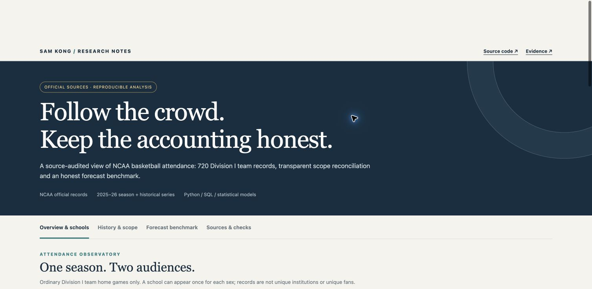
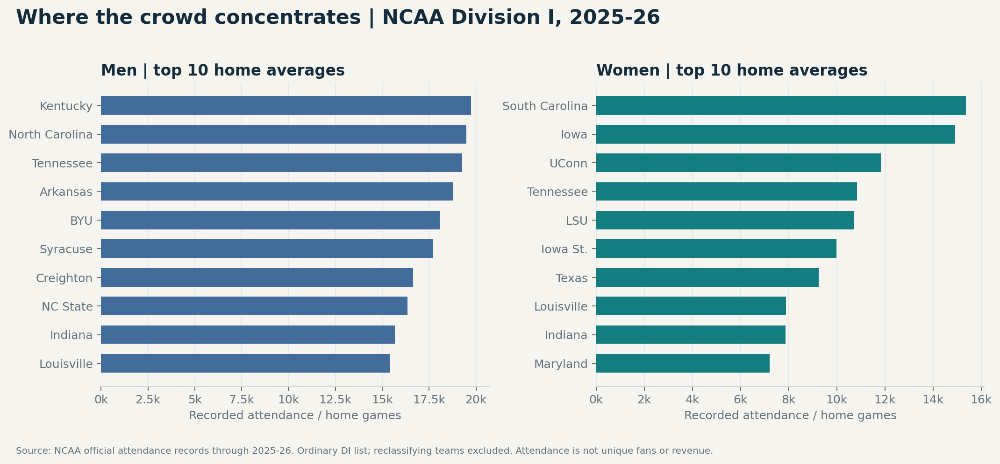
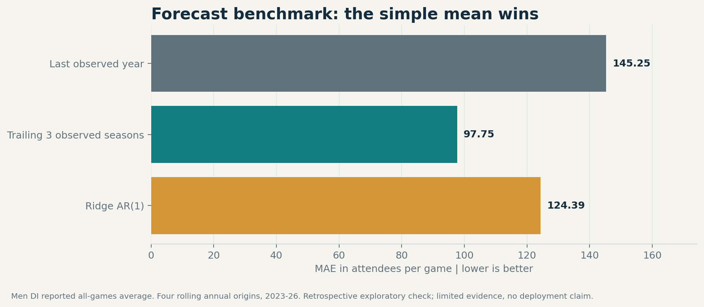
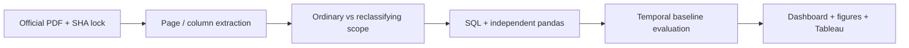

# NCAA Attendance Observatory

[](https://github.com/xkong585/fan-ticketing-bi/actions/workflows/reproduce.yml)

**Official NCAA data · 2025–26 season · Python / SQL / Tableau / interactive reporting**

Which teams draw the largest crowds, how have audiences changed, and can a statistical model outperform simple forecasting baselines? This project answers those questions with official records and an explicit audit of source inconsistencies.

**[Live dashboard](https://xkong585.github.io/fan-ticketing-bi/)** · [Local report](reports/index.html) · [Tableau package](tableau/fan_ticketing.twbx) · [Quantified resume bullets](docs/resume_bullets.md)



## Results at a glance

- Parsed **720 ordinary Division I team records**: 361 men's and 359 women's teams, covering **10,917 home games** and **33,001,062 recorded attendance** in the school lists. These are team/sex records and attendances, not unique institutions, fans, ticket transactions or revenue.
- Reconciled men's school totals exactly to the official summary. For women, traced a **22,766-attendance / 59-game** summary difference exactly to four separately listed reclassifying teams; keep the ordinary list and reported summary scopes separate.
- Retained the missing 2021 season and a conflicting women's 2025 historical field instead of filling or silently overwriting them. The forecast excludes that female historical series.
- On **four rolling annual origins (2023–26)**, the trailing three-observed-season mean achieved **MAE 97.75 attendees**, compared with **145.25** for last-year persistence and **124.39** for Ridge AR(1). The simple mean wins; this small retrospective comparison does not establish deployment readiness.
- Independently reconciled attendance marts across SQL and pandas. The local SQL materialization benchmark uses actual source rows, exact output checks and recorded construction cost; it does not claim cloud latency or scale.

## Explore the findings

The dashboard supports category and school filters, ratio-safe cohort KPIs, top-10/top-25 rankings, CSV export, historical scope inspection, model comparison and source checks.





## Official sources and analytical grain

| Source | Grain and use |
| --- | --- |
| [NCAA men's basketball attendance records](https://s3.amazonaws.com/fs.ncaa.org/Docs/stats/m_basketball_RB/Attend.pdf) | Pages 2, 4–7 and 18: school home list, summary and DI historical all-games series |
| [NCAA women's basketball attendance records](https://s3.amazonaws.com/fs.ncaa.org/Docs/stats/w_basketball_RB/Attend.pdf) | Pages 2, 6–8 and 10: school home list, separate reclassifying rows and historical context |

The URLs can be updated in place by NCAA. The exact downloaded bytes, retrieval date and SHA-256 are recorded in the source lock. Source PDFs are not redistributed in this repository; derived factual tables retain page/column provenance. Current historical values can contain revisions, so the forecast is not an archived-vintage backtest.



## Reproduce

```bash
python3 -m venv .venv
source .venv/bin/activate
pip install -r requirements.lock.txt
bash run_all.sh
```

Python 3.12. The first run downloads official source files; no API key, account or paid database is needed. SHA-256 locks detect source drift. Raw sources and participant-level records stay in ignored `data/` directories; public reports contain aggregates only. Tests and numerical checks must pass before report readiness is written.

## Review the evidence

- [Source manifest](evidence/source_manifest.json) and [source lock](docs/source_lock.json)
- [Analysis protocol](docs/analysis_plan.md), [metric dictionary](docs/metric_dictionary.md), [limitations](docs/limitations.md)
- [Summary](evidence/summary.json), [numerical checks](evidence/checks.json), [tests](tests/test_pipeline.py)
- [English resume wording](docs/resume_bullets.md) · [中文说明](docs/README_CN.md)

## Version boundary

**Version 2 replaces the former synthetic demonstration with official-source analysis.** The former generated transactions, survey responses, randomized experiment and sponsor contracts are not evidence for this version. They are retained only in the historical `v1-synthetic-demo` Git tag; do not reuse its metrics as real business achievements. This is independent portfolio research with no affiliation to the source organizations or any sports team.
